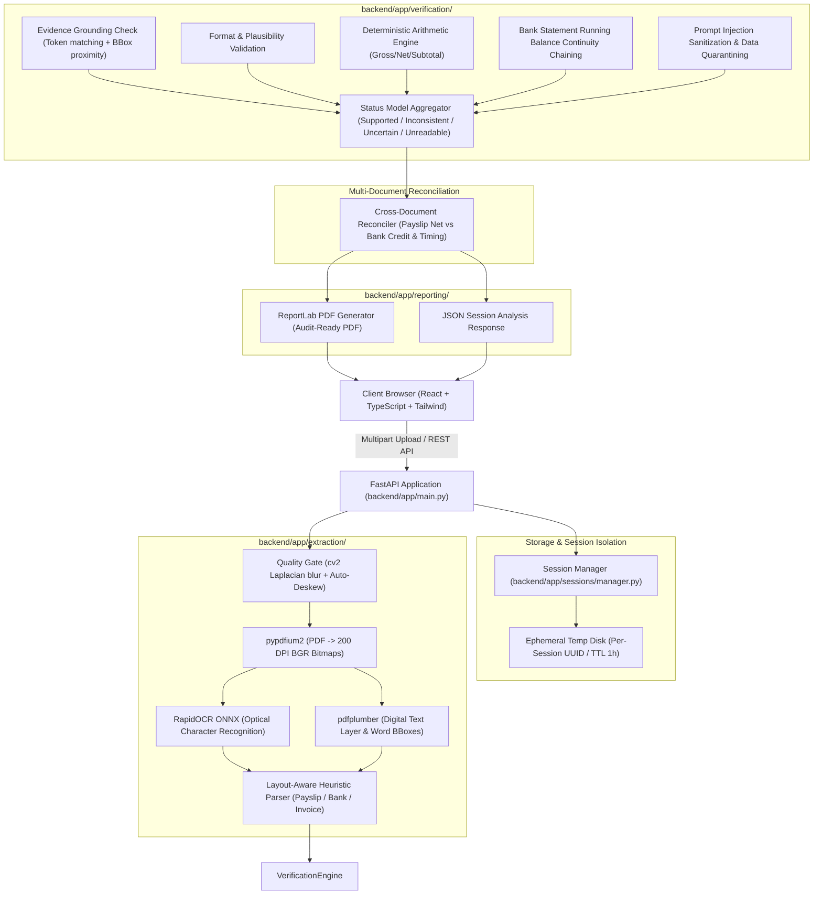
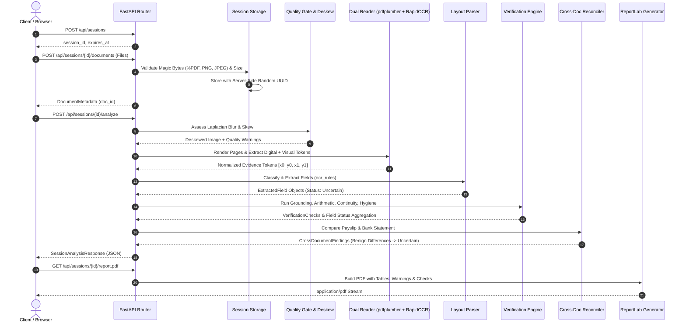

# VeriDocs AI — System Architecture & Technical Specifications

VeriDocs AI is an evidence-grounded financial document intelligence and consistency verification system. It operates on the foundational principle:
> **Core Axiom:** *An AI model must never be trusted to verify its own output. Extraction proposes; independent deterministic code decides.*

---

## 1. System Architecture Diagram

---

## 2. End-to-End Sequence Diagram

---

## 3. Privacy, Security & Resource Boundaries

1. **Untrusted Data Isolation**: All text extracted from documents is treated exclusively as untrusted data payloads inside schema objects. Text is never concatenated into shell commands, system calls, or unescaped model prompts.
2. **Privacy-Preserving Logs**: Structured logs record only session UUIDs, document types, processing latencies, and status counts. Document contents, names, salaries, and account numbers are strictly excluded from logs.
3. **Decompression Bomb Protection**: Pillow's `MAX_IMAGE_PIXELS` is strictly clamped to 25 megapixels to prevent zip-bomb / pixel-flood memory denial-of-service attacks.
4. **Per-Session TTL Cleanup**: Uploaded files reside in `data/sessions_temp/{session_id}`. Deleting a session via `DELETE /api/sessions/{id}` immediately purges all files from disk. Expired sessions are automatically cleared by TTL sweepers.
5. **Permissive Licensing**: The system uses zero AGPL/copyleft dependencies, relying on Apache-2.0 (`pypdfium2`, `RapidOCR`, `OpenCV`), MIT (`pdfplumber`, `FastAPI`, `Pydantic`, `RapidFuzz`), and BSD-3-Clause (`ReportLab`, `NumPy`, `SciPy`).
